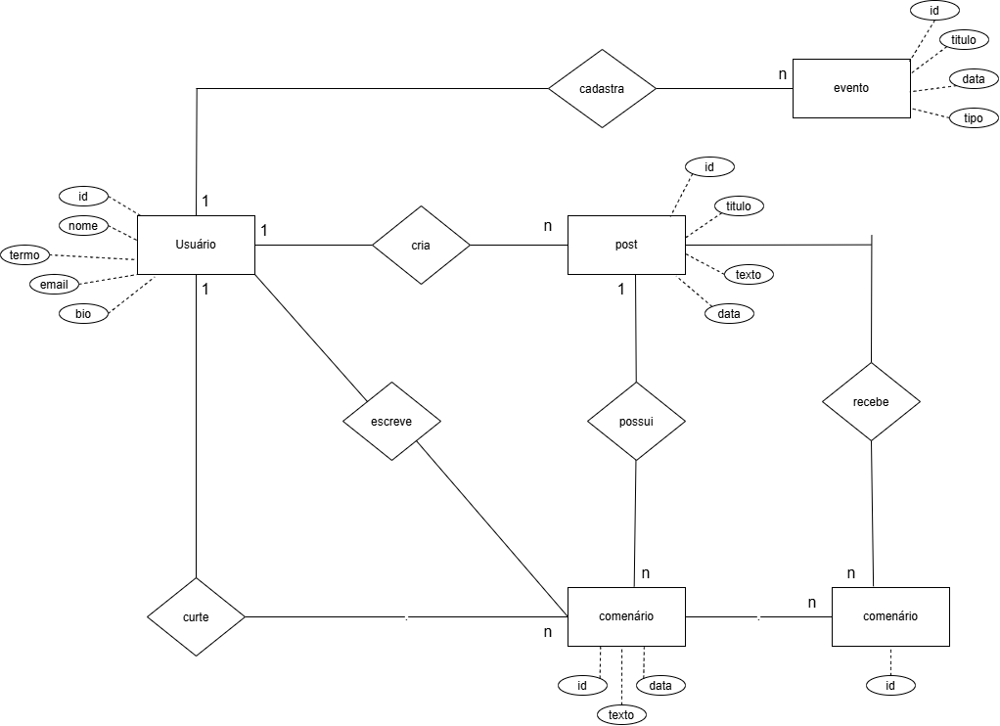

# Diagrama Entidade-Relacionamento

## Entidades identificadas

- **Usuário**: possui atributos como `id`, `nome`, `email`, `bio` e `termo`.
- **Post**: possui `id`, `titulo`, `texto` e `data`.
- **Evento**: possui `id`, `titulo`, `data` e `tipo`.
- **Comentário**: possui `id`, `texto` e `data`.

## Relacionamentos

- Um usuário cria várias postagens e cadastra vários eventos.
- Um usuário escreve e curte comentários.
- Uma postagem possui comentários.
- Comentários podem receber outros comentários.
